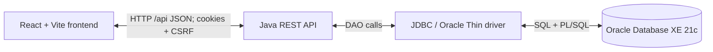

# Centralized Blood Bank & Emergency Routing System

A DBMS course project connecting a React interface to a Java REST API and Oracle Database through JDBC. Citizens can find compatible blood availability, while approved hospital staff can inspect inventory, record blood requirements, and reserve compatible units using first-expiry-first-out (FEFO) allocation.

Developed for **BACSE202 Database Systems, VIT Vellore**.

## Problem statement and objectives

Separate hospital inventories make it difficult to locate compatible blood and coordinate requests. This project brings hospital, donor, inventory, request, allocation, and audit records into a relational database to:

- Find nearby hospitals with compatible, available blood.
- Restrict hospital operations to approved staff and their assigned hospital.
- Reserve unexpired units in FEFO order and prevent duplicate live allocations.
- Track expiry and preserve a history of blood-bag status changes.

## Key features

- **Citizen accounts:** registration, sign-in, logout, and session restoration after refresh; donor registration is a separate action.
- **Hospital and blood search:** Oracle-backed hospital listing and compatible red-cell availability by pincode and blood group.
- **Staff access:** registration against an active hospital, followed by **manual administrator verification and approval** before sign-in.
- **Inventory dashboard:** total, available, reserved, and near-expiry counts, bag details, and status filtering for the assigned hospital.
- **Emergency requests:** record a hospital blood requirement and separately allocate available units against its request reference.
- **Compatible FEFO allocation:** reserve eligible bags by expiry date, collection date, then bag ID.
- **Expiry and audit records:** seven-day near-expiry alerts and logged reservation transitions with actor, time, and request reference.

This is an academic project, not a clinically validated or production-ready blood-bank system. No deployment automation is provided. Requests currently represent hospital stock requirements; the React form does not collect patient identity. Allocation reserves stock; physical issue of blood is a separate operation outside this UI.

## Technology stack

| Layer | Technology |
| --- | --- |
| Frontend | React 19, Vite 8, JavaScript, CSS |
| REST backend | Java 17+, JDK HTTP server (`com.sun.net.httpserver`) |
| Database connectivity | JDBC, Oracle Thin driver |
| Database | Oracle Database XE 21c, SQL, PL/SQL |
| Development and tests | PowerShell, npm, Node.js test runner; Java regression scripts |

Node.js is required for frontend tooling and tests. The application API runs in Java.

## Architecture



Java authenticates requests and derives hospital scope from the session. JDBC reads and writes Oracle; PL/SQL implements compatibility and reservation. The browser never connects directly to Oracle.

## Database schema

The current schema contains **eight tables**. IDs are numeric and generated using sequences; Oracle stores blood group and Rh together (for example, `A+`).

| Table | Purpose and important relationships |
| --- | --- |
| `HOSPITAL` | Hospital directory, coordinates, pincode, and active status; parent of staff assignments, bags, and requests. |
| `USERS` | Unique email, password hash, role, account status, and login metadata; referenced by staff assignments and requests. |
| `HOSPITAL_STAFF` | Links a user to one hospital; `USER_ID` is unique. Many staff may belong to a hospital. |
| `DONOR` | Donor identity, blood group, contact details, and last donation date. No direct `USERS` foreign key exists. |
| `BLOOD_BAGS` | One row per unit at a hospital, with collection/expiry dates and status; optional donor link also enforces matching blood group. |
| `REQUEST` | Requesting user, supplying hospital, blood group, quantity, priority, allocated count, and processing status. |
| `ALLOCATION` | Links requests to bags and records reservation history; a unique function-based index permits at most one live allocation per bag. |
| `BAG_STATUS_LOG` | Bag status transitions, timestamp, actor, reason, and optional request reference. |

See [schema definitions](database/schema_baseline.sql), [database documentation](database/README_DATABASE.md), and [Java/database contract](database/api_database_contract.md). Some supporting documents retain earlier implementation notes; current runtime behavior is described here and in the source code.

## Repository structure

```text
centralized-blood-bank-system/
|-- README.md
|-- frontend/
|   |-- src/
|   |   |-- auth/           # Session context and route guards
|   |   |-- components/     # Shared form and feedback components
|   |   |-- pages/          # Landing, auth, citizen, hospital, request screens
|   |   |-- services/       # Live API transport and authentication
|   |   |-- App.jsx
|   |   `-- styles.css
|   |-- tests/              # Automated frontend tests
|   |-- .env.example
|   |-- package.json
|   |-- package-lock.json
|   `-- vite.config.js
|-- backend/
|   |-- src/main/java/com/bloodbank/
|   |   |-- config/         # Oracle JDBC configuration
|   |   |-- dao/            # Database operations
|   |   |-- server/         # REST server
|   |   `-- util/
|   |-- src/test/java/      # Java regression tests and test-only JDBC double
|   |-- run-backend.ps1
|   |-- run-backend.bat
|   |-- run-tests.ps1
|   |-- pom.xml
|   `-- postman_collection.json
|-- database/
|   |-- schema_baseline.sql
|   |-- views.sql
|   |-- procedures.sql
|   |-- sample_data.sql
|   |-- tests.sql
|   |-- api_database_contract.md
|   |-- schema_gaps.md
|   `-- README_DATABASE.md
`-- docs/
    |-- course-overview.pptx
    |-- phase-1/review-1.pdf
    `-- phase-2/README.md
```

## Local setup on Windows

### 1. Install prerequisites and clone

Install Git, PowerShell, JDK 17 or newer (including `javac`), Node.js 22.12+ or a supported newer version, and npm. **Oracle Database XE 21c must already be installed and properly configured**, with a running database service and listener. SQL*Plus or SQLcl is needed for database administration. Obtain an Oracle JDBC driver JAR compatible with your JDK and database. Maven is optional.

```powershell
git clone https://github.com/aaaayushiiii/centralized-blood-bank-system.git
cd centralized-blood-bank-system
java -version
javac -version
node --version
npm --version
```

### 2. Prepare Oracle and the application schema

**Current verified local state:** the project tables are owned by `SYSTEM` in `XEPDB1`. The attempted `BLOODBANK` account was not successfully provisioned with the schema and is not an operational application account. This describes the existing academic setup, not a recommendation to use `SYSTEM` for regular application access.

**Recommended future improvement:** have an administrator provision a dedicated application account with only the required privileges and migrate or expose the approved objects deliberately. The current code uses unqualified object names; a separate schema requires the objects to be available to that account. No automated account-provisioning or schema-migration script is included. Do not switch credentials to an empty account or recreate the existing schema as part of startup.

- **Existing project database:** reuse its approved schema and data. Do not rerun schema or sample-data scripts. Check that the eight tables, sequences, four views, two functions, and four procedures described below exist and are valid.
- **New, empty development schema only:** have the database owner review [the setup documentation](database/README_DATABASE.md). The supplied order is `schema_baseline.sql`, `views.sql`, then `procedures.sql`. Schema creation requires `CREATE TABLE`, `CREATE VIEW`, `CREATE PROCEDURE`, and `CREATE SEQUENCE`, in addition to connection access and tablespace quota.
- `sample_data.sql` is optional test data: it deletes/replaces reserved test ranges and dependent records, then **commits**. It must not be used to reset an existing integrated database. Seed accounts contain placeholder hashes and cannot sign in; use application registration for usable accounts.
- `tests.sql` performs database mutations before rollback and belongs in a dedicated test schema, not the ordinary application startup sequence.

A read-only object check in SQL*Plus:

```sql
SELECT object_name, object_type, status
FROM user_objects
WHERE object_type IN ('TABLE', 'SEQUENCE', 'VIEW', 'FUNCTION', 'PROCEDURE')
ORDER BY object_type, object_name;

SELECT name, type, line, text FROM user_errors ORDER BY name, sequence;
```

### 3. Start the Java backend - PowerShell terminal 1

From the repository root:

```powershell
cd backend
$env:ORACLE_URL = 'jdbc:oracle:thin:@//localhost:1521/XEPDB1'
$env:ORACLE_USER = Read-Host 'Current schema owner username (see Oracle setup above)'
$env:ORACLE_PASSWORD = [System.Net.NetworkCredential]::new('', (Read-Host 'Database password' -AsSecureString)).Password
$env:OJDBC_JAR = 'C:\app\Aayushi\product\21c\dbhomeXE\jdbc\lib\ojdbc11.jar'
.\run-backend.ps1
```

The team-verified local setup is Oracle XE 21c, listener `localhost:1521`, service `XEPDB1`, and the installed `ojdbc11.jar` at the path above. Other machines must supply their own valid driver path and Oracle connection settings. Set `JAVA_HOME` to your installed JDK if `java`/`javac` are not on PATH. Enter credentials locally; do not paste them into source files, screenshots, or Git. The password prompt hides input and avoids putting the password in command history. Java requires it as a process environment variable, which holds plaintext while the backend runs; it is not stored in the README or a configuration file.

The launcher validates required variables, compiles production sources with `javac --release 17` into a unique temporary directory, and starts Java with the supplied driver on its classpath. It does not load `.env` files or install Oracle objects. `run-backend.bat` delegates to this PowerShell script.

The verified launcher uses the installed `ojdbc11.jar` directly and does not require Maven. `pom.xml` separately declares `com.oracle.database.jdbc:ojdbc8:19.8.0.0`; that optional Maven configuration was not verified in the reported local setup and is not the driver used by the commands above.

### 4. Start React - PowerShell terminal 2

From the repository root:

```powershell
cd frontend
npm ci
if (-not (Test-Path .env)) { Copy-Item .env.example .env }
npm run dev
```

Ensure the local `frontend/.env` has these public settings; preserve any existing configuration rather than overwriting it:

```dotenv
VITE_API_MODE=live
VITE_API_BASE_URL=http://127.0.0.1:8080/api
```

Restart Vite after changing these values. Never put database credentials in frontend environment variables. Open **http://127.0.0.1:5173/#/roles**, or the URL Vite prints. Keep frontend and API hostnames consistent for cookies. If Vite selects another port, configure the Java `CORS_ORIGINS` accordingly and restart the backend.

| Backend variable | Default / requirement |
| --- | --- |
| `ORACLE_URL`, `ORACLE_USER`, `ORACLE_PASSWORD` | Required; supplied in backend terminal |
| `OJDBC_JAR` | Required by launcher; absolute path to driver JAR |
| `PORT` / `BIND_ADDRESS` | `8080` / `127.0.0.1` |
| `CORS_ORIGINS` | `http://localhost:5173,http://127.0.0.1:5173` |
| `COOKIE_SECURE` | `false` for local HTTP; `true` requires HTTPS |

### 5. Verify health and access

In another PowerShell terminal:

```powershell
Invoke-RestMethod http://127.0.0.1:8080/api/health
```

Expected on a healthy connection: `status` is `UP` and `database_connected` is `true`. This validates a real JDBC connection, not the completeness of the schema. Oracle connection/configuration failures return HTTP 503.

Use `#/citizen/sign-up` and `#/citizen/sign-in` for citizens. Staff request access at `#/hospital/request-access`; an administrator must independently verify the hospital assignment and activate the pending account. **There is no approval API or administrator UI.** Approved staff sign in at `#/hospital/sign-in`, then use `#/hospital` and `#/request`.

Sessions use HttpOnly, SameSite=Lax cookies. React checks `/api/auth/me` before granting access and includes CSRF headers on POSTs. A guest `/auth/me` response of 401 with a CSRF token is expected. Authenticated sessions expire after eight hours and are lost when the Java server restarts.

### 6. Stop servers safely

Press **Ctrl+C** in the React terminal and **Ctrl+C** in the Java terminal. Java has a shutdown hook to stop the HTTP server and executor. Wait for an in-flight mutation to finish before stopping; already committed Oracle changes are not undone by stopping either server. After the backend exits, remove its password variable from that terminal:

```powershell
Remove-Item Env:ORACLE_PASSWORD
```

## Key REST API endpoints

Paths below include `/api` and are verified against `BloodBankServer.java`. Every POST requires a session cookie and `X-CSRF-Token`; React handles the handshake.

| Method | Endpoint | Purpose / access |
| --- | --- | --- |
| GET | `/api/health` | Validate Oracle JDBC connectivity |
| GET | `/api/auth/me` | Guest CSRF bootstrap or authenticated session |
| POST | `/api/auth/register/citizen` | Register citizen; does not sign in |
| POST | `/api/auth/register/hospital` | Request staff access; pending manual approval |
| POST | `/api/auth/login` | Authenticate citizen or approved staff; rotate session |
| POST | `/api/auth/logout` | Invalidate session and expire cookie |
| GET | `/api/hospitals` | Active directory; staff receive their assigned hospital |
| GET | `/api/hospitals/nearby` | Search by `pincode`, `blood_group`, `rh_factor`; optional `radius` or explicit `lat`/`lon` |
| GET | `/api/hospitals/{id}/inventory` | Approved staff inventory; actual scope comes from session |
| POST | `/api/donors` | Citizen donor registration |
| POST | `/api/requests` | Staff creates a committed `PENDING` hospital requirement |
| GET | `/api/requests/{id}/allocations` | Read stored allocations with ownership checks |
| POST | `/api/requests/{id}/allocations` | Staff triggers compatible FEFO reservation for own hospital |

Existing aliases: GET `/api/blood/search`, GET `/api/inventory/dashboard`, POST `/api/requests/emergency`. The last creates a request only; it does not allocate blood. See [backend documentation](backend/README.md) and the [Postman collection](backend/postman_collection.json).

Search uses the centroid of active geolocated hospitals for a supplied pincode; it is an approximate origin, not full postal geocoding. Unknown pincodes return `422 LOCATION_UNKNOWN`. Counts include compatible donor groups, not just the exact requested group.

## SQL and PL/SQL features

- **Integrity:** primary/foreign keys, unique email and bag codes, blood-group/status/quantity/date checks, sequence-generated IDs, and indexes supporting hospital lookup and FEFO. `uq_alloc_active_bag` prevents multiple live reservations/issues for the same bag.
- **Views:** `V_DASHBOARD_INVENTORY`, `V_DASHBOARD_TOTALS`, `V_AVAILABLE_BAG_DETAIL`, and `V_REQUEST_ALLOCATION_DETAIL` provide aggregates, eligible stock rankings, and allocation details.
- **Functions:** `FN_IS_RBC_COMPATIBLE` checks red-cell compatibility; `FN_HAVERSINE_KM` calculates geographic distance.
- **Procedures:** `PRC_NEARBY_HOSPITALS` searches stock; `PRC_ALLOCATE_FEFO` reserves eligible bags; `PRC_EMERGENCY_DISPATCH` validates and processes requests; `PRC_EXPIRE_STALE_BAGS` can mark stale available bags expired and log changes. No automatic expiry scheduler is included.
- **Expiry rule:** available means `STATUS = 'AVAILABLE' AND EXPIRY_DATE > TRUNC(SYSDATE)`. Bags expiring today are unavailable; dashboard alerts cover available units within seven days using Oracle's date.
- **Transaction safety:** Java owns commit/rollback; procedures do not commit. Dispatch uses savepoints, request-row locking, and `FOR UPDATE SKIP LOCKED` for bags. FEFO follows expiry, collection date, and bag ID among unlocked eligible stock. Repeated dispatch of a processed request is refused.
- **Allocation outcomes:** Java allows partial fulfilment. Requests become `FULFILLED`, `PARTIALLY_FULFILLED`, or `REJECTED` for full, partial, or zero reservations. Priority is stored (`Critical` -> `CRITICAL`, `Urgent` -> `HIGH`, `Routine` -> `NORMAL`); there is no automatic cross-request priority scheduler.
- **Audit:** each reservation inserts an `ALLOCATION`, changes its bag from `AVAILABLE` to `RESERVED`, and records the actor and request in `BAG_STATUS_LOG`. A later SQL*Plus rollback cannot undo a transaction already committed by Java.

## Testing and verification

Run the existing automated suites from the repository root:

```powershell
Push-Location frontend
npm test
npm run build
Pop-Location
Push-Location backend
.\run-tests.ps1
Pop-Location
```

Frontend tests cover transport, authentication, CSRF/cookie contracts, role checks, response validation, and hospital/search lifecycle behavior using synthetic responses. The Java script runs DAO and HTTP regression tests with a test-only JDBC double; it does not prove real Oracle execution or concurrent locking. `database/tests.sql` is a separate mutating SQL/PLSQL test suite for a dedicated test schema.

**Previously verified:** the cleanup phase passed 25 frontend tests and a production build. The team reported live React -> Java -> JDBC -> Oracle verification of citizen registration/login and refresh persistence, hospital listing/search, manual staff approval/login, inventory counts against SQL, and fulfilled requests `100000` and `100001`. The FEFO check selected A+ bag `95602` before later-expiring `95601`; audit rows confirmed `AVAILABLE` -> `RESERVED` transitions. These are recorded project results, not tests rerun for this documentation update. Concurrent Oracle locking and the optional Maven setup are not claimed as verified.

`npm run preview` in `frontend/` serves the production build locally; when using it with the API, explicitly configure its frontend origin in backend CORS settings.

## Team and contributions

| Member | Registration number | Contribution |
| --- | --- | --- |
| Aarnaa | 25BCE0675 | DML, PL/SQL, views |
| Aayushi | 25BCE0646 | React frontend and GitHub integration |
| Ankita | 25BCE0649 | Java REST backend and JDBC |
| Muskan | 25BCE2039 | Oracle DDL and schema |

## Academic context

**BACSE202 Database Systems - VIT Vellore.** The project demonstrates relational modelling, constraints, SQL, PL/SQL, JDBC connectivity, transaction handling, and application integration. Course material is preserved in [the course overview](docs/course-overview.pptx) and [Phase 1 review](docs/phase-1/review-1.pdf).
